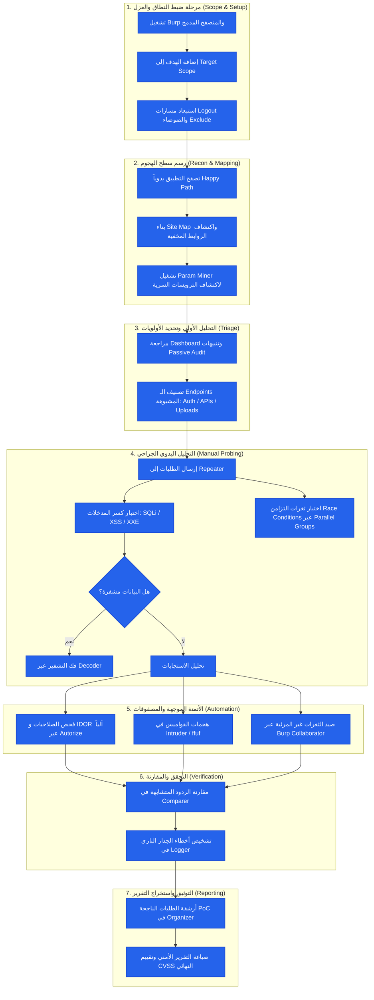

# 17. منهجية الفحص الشاملة (Pentest Workflow)

> 🌐 **اللغة / Language:** [English Version (`en/17-pentest-workflow.md`)](../en/17-pentest-workflow.md)

---

## 🎯 الهدف من الفصل

تجميع كافة الأدوات والتقنيات التي تم شرحها في الفصول السابقة داخل **إطار عمل منهجي موحد (End-to-End Pentest Workflow)**، وفهم التسلسل المنطقي لانتقال البيانات بين أدوات Burp Suite المختلفة، ورسم خريطة طريق واضحة تقود مختبر الاختراق من مرحلة الاستكشاف الأولي (Reconnaissance) وحتى توثيق الأدلة واستخراج التقرير النهائي.

---

## 🔍 كيف تعمل الأداة (Technical Explanation)

اختبار اختراق تطبيقات الويب ليس عملية عشوائية للنقر على الأزرار؛ بل هو تسلسل تكتيكي من 7 مراحل رئيسية، تغذي فيه كل مرحلة الأدوات التي تليها:

### 📊 المخطط الانسيابي الشامل لمنهجية الفحص (Mermaid Workflow)

---

## 🛠️ التطبيق العملي (Step-by-Step)

### تنفيذ دورة الفحص الكاملة على تطبيق تجريبي:

1. **الخطوة 1 (ضبط النطاق):**
   * أضف نطاق العميل `*.target-app.com` إلى `Target > Scope`.
   * فعّل خيار `Show only in-scope items` في كل التابات لمنع التشتت.

2. **الخطوة 2 (الاستكشاف السطحي والعميق):**
   * افتح المتصفح المدمج وسجل حساباً تجريبياً وتصفح كافة أقسام الموقع لملء الـ `Site Map`.
   * انقر كليك يمين على مسار الـ API واختر **Guess params** عبر إضافة `Param Miner`.

3. **الخطوة 3 (فحص الصلاحيات والـ IDOR التلقائي):**
   * جهز إضافة `Autorize` بكوكي مستخدم عادي، واستمر في تصفح الموقع بحساب المدير.
   * راقب ظهور الإشارات الحمراء (`Bypassed!`) في Autorize.

4. **الخطوة 4 (التحليل اليدوي المتقدم في Repeater):**
   * أرسل الطلبات التي تحتوي على باراميترات معقدة إلى Repeater.
   * اختبر سلامة معالجة البيانات، وتلاعب بترويسات `Content-Type` والأفعال (`GET` vs `POST`).

5. **الخطوة 5 (رصد الثغرات غير المباشرة OAST):**
   * احقن نطاق `Burp Collaborator` في كل حقل يطلب روابط خارجية للتحقق من ثغرات Blind SSRF.

6. **الخطوة 6 (توثيق الأدلة):**
   * كل ثغرة مؤكدة، اضغط عليها `Ctrl + O` لإرسالها فوراً إلى `Organizer` مع كتابة خطوات إعادة الإنتاج وملاحظات الخطورة.

---

## 🧪 Lab مقترح

* **المعمل التطبيقي:** [PortSwigger Academy: Comprehensive Application Walkthrough](https://portswigger.net/web-security/all-labs)
  * اختر أي معمل متقدم لم يسبق لك حله، وطبق عليه المنهجية الكاملة الموضحة في المخطط من الخطوة 1 إلى الخطوة 7.

---

## ⚔️ منظور المهاجم (Attacker) vs. 🛡️ منظور المدافع (Defender)

* **⚔️ منظور المهاجم:**
  * اتباع منهجية صارمة يمنع الفاحص من القفز العشوائي بين الأدوات، ويضمن تغطية 100% من سطح الهجوم واكتشاف الثغرات العميقة التي يفوتها الفحص السطحي السريع.
* **🛡️ منظور المدافع:**
  * فهم المدافع لهذه المنهجية يساعده على تصميم نماذج تهديد واقعية (**Threat Modeling**)، وإدراك أن تأمين واجهة الدخول لا يعني حماية التطبيق إذا كانت واجهات الـ API الخلفية غير خاضعة لنفس معايير التحقق.

---

## ❌ أخطاء شائعة للمبتدئين

> [!WARNING]
> 1. **القفز فوراً إلى الفحص الآلي العنيف:** تشغيل الـ Scanner أو Intruder فور فتح الموقع دون فهم طبيعة التطبيق، مما يؤدي لحظر عنوان IP الخاص بك أو تدمير بيانات الحساب التجريبي.
> 2. **تجاهل تدوين الملاحظات أثناء العمل:** تأجيل توثيق الثغرات حتى نهاية اليوم، لتكتشف أنك نسيت أي باراميتر كان مصاباً وأي ترويسة أدت لنجاح الهجوم.
> 3. **عدم فحص وظائف العمليات متعددة الخطوات (Multi-step workflows):** تفويت اختبار خطوة تأكيد الدفع أو تغيير كلمة المرور عند تجاوز إحدى الخطوات الوسيطة مباشرة.

---

## 📚 مراجع

1. [OWASP Web Security Testing Guide (WSTG v4.2)](https://owasp.org/www-project-web-security-testing-guide/)
2. [PTES: Penetration Testing Execution Standard](http://www.pentest-standard.org/)
3. [Bug Bounty Bootcamp: The Guide to Finding and Reporting Web Vulnerabilities (Vickie Li)](https://nostarch.com/bug-bounty-bootcamp)

---

| [← السابق: 16. ثغرات تهريب الطلبات](./16-http2-request-smuggling.md) | [الفهرس](../README.md#🗂️-فهرس-الفصول-النسخة-العربية---ar) | [التالي: 18. كتابة التقرير الأمني وتوثيق الثغرات →](./18-reporting.md) |
