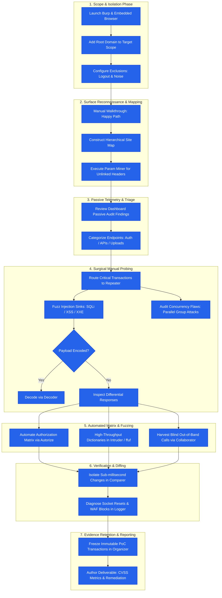

# 17. Comprehensive Web Penetration Testing Workflow

> 🌐 **Language / اللغة:** [النسخة العربية (`ar/17-pentest-workflow.md`)](../ar/17-pentest-workflow.md)

---

## 🎯 Chapter Objectives

Synthesize all independent Burp Suite modules and extensions examined throughout this guide into an integrated, repeatable **Offensive Penetration Testing Methodology (Workflow)**, map the deterministic data flow between tools, and execute structured assessments from initial passive reconnaissance to verified proof-of-concept evidence archival.

---

## 🔍 Technical Explanation

Professional web application penetration testing is not an ad-hoc process of random button-clicking. It is an ordered tactical progression structured across seven distinct phases where upstream telemetry feeds downstream verification engines:

### 📊 End-to-End Methodological Architecture (Mermaid Workflow)

---

## 🛠️ Step-by-Step Hands-On Guide

### Executing the Complete Assessment Cycle:

1. **Phase 1 (Scope & Traffic Guardrails):**
   * Define your target scope rule: `^https://.*\.target-app\.com/`.
   * Enable `Show only in-scope items` across Proxy, Target, and Logger to eliminate visual clutter.

2. **Phase 2 (Attack Surface Discovery):**
   * Launch Burp's embedded browser, complete standard user registration flows, and interact with every UI component to populate the `Site Map`.
   * Right-click the root API folder and select **Extensions > Param Miner > Guess params** to uncover unindexed parameters.

3. **Phase 3 (Automated Authorization Matrixing):**
   * Feed a low-privileged test user's cookie session into **Autorize**.
   * Re-browse the entire administrative tier using an administrator account, monitoring the Autorize log for red `Bypassed!` alerts.

4. **Phase 4 (Targeted Verification in Repeater):**
   * Forward suspicious transactions to Repeater (`Ctrl + R`).
   * Perform boundary probing, header injection, and test for race conditions by grouping identical requests into **Parallel Tab Groups**.

5. **Phase 5 (Out-of-Band Verification):**
   * Inject ephemeral Burp Collaborator domains into callbacks, webhooks, and asynchronous PDF generators to trap blind SSRF or XXE callbacks.

6. **Phase 6 (Evidence Freezing in Organizer):**
   * For every confirmed vulnerability, press `Ctrl + O` to store an immutable snapshot inside **Organizer**, appending technical notes and reproduction steps.

---

## 🧪 Recommended Labs

* **Interactive Lab:** [PortSwigger Academy: Comprehensive Application Walkthrough](https://portswigger.net/web-security/all-labs)
  * Select an uncompleted advanced challenge and methodically apply all seven phases of the workflow from initial scope definition to final proof-of-concept capture.

---

## ⚔️ Attacker vs. 🛡️ Defender Perspective

* **⚔️ Attacker Perspective:**
  * Strict adherence to a standardized methodology guarantees full coverage of the target attack surface, eliminating the blind spots that lead to missed vulnerabilities.
* **🛡️ Defender Perspective:**
  * Understanding this end-to-end testing workflow allows security architects to design effective **Defense-in-Depth** strategies, recognizing that perimeter WAFs are useless if internal authorization layers fail.

---

## ❌ Common Beginner Mistakes

> [!WARNING]
> 1. **Immediate High-Volume Scanning without Context:** Running automated scanners or Intruder dictionary attacks immediately upon opening a site, causing IP bans and triggering blue-team alarms before reconnaissance is complete.
> 2. **Postponing Evidence Documentation:** Delaying the recording of proof-of-concept steps until the end of an engagement, only to discover session state has expired or endpoints have changed.
> 3. **Skipping Multi-Step Workflow Testing:** Failing to test intermediate steps in critical business logic flows (such as order checkout or password resets) for missing validation checks.

---

## 📚 References

1. [OWASP Web Security Testing Guide (WSTG v4.2)](https://owasp.org/www-project-web-security-testing-guide/)
2. [Penetration Testing Execution Standard (PTES)](http://www.pentest-standard.org/)
3. [Bug Bounty Bootcamp: Finding and Reporting Web Vulnerabilities](https://nostarch.com/bug-bounty-bootcamp)

---

| [← Previous: 16. HTTP/2 & Request Smuggling](./16-http2-request-smuggling.md) | [TOC](../README.en.md#🗂️-table-of-contents-english-version---en) | [Next: 18. Security Reporting & Documentation →](./18-reporting.md) |
